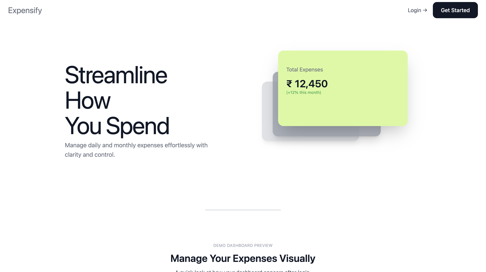
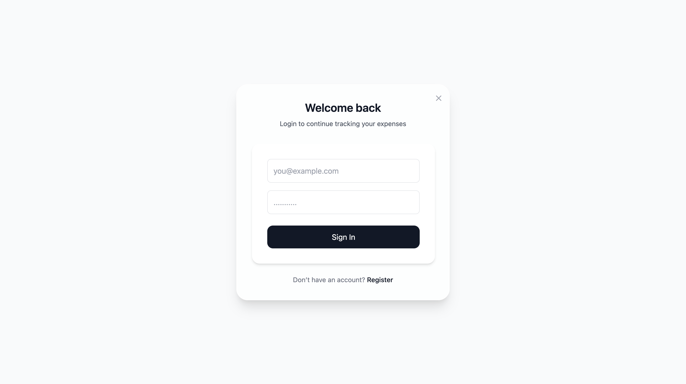
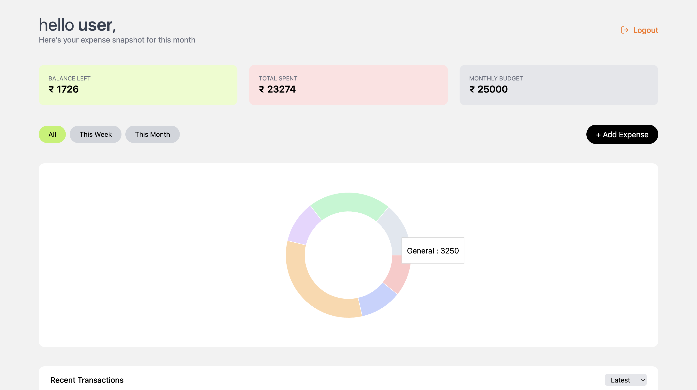

# 💸 penny — Frontend

A modern, responsive **expense tracking web application** built with **React + Vite**, focused on clean UX, real-world authentication, and data visualization.

This frontend consumes a secure REST API and allows users to track, analyze, and manage their expenses seamlessly.

---

## ✨ Features

- 🔐 JWT-based Authentication (Login & Register)
- 🧾 Add, edit, delete expenses
- 📊 Expense analytics & summaries
- 📅 Filter by time period
- 🔒 Protected routes
- 🔔 Toast notifications
- 📱 Fully responsive UI
- 🎨 Clean, minimal design

---
##  Screenshots

  

  

  

---
## 🛠 Tech Stack

- React (Vite)
- React Router DOM
- Axios
- Tailwind CSS
- JWT Authentication

---

Running Locally
npm install
npm run dev

App runs on:
http://localhost:5174

