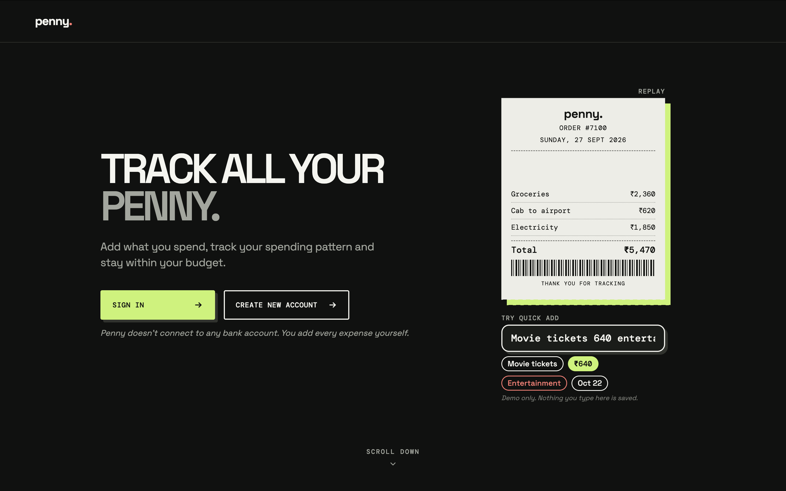
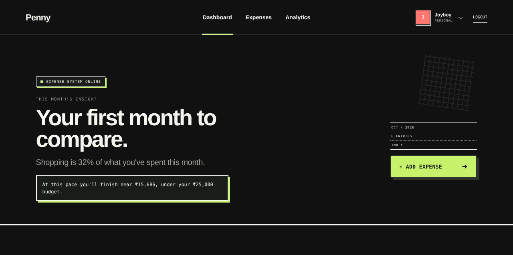
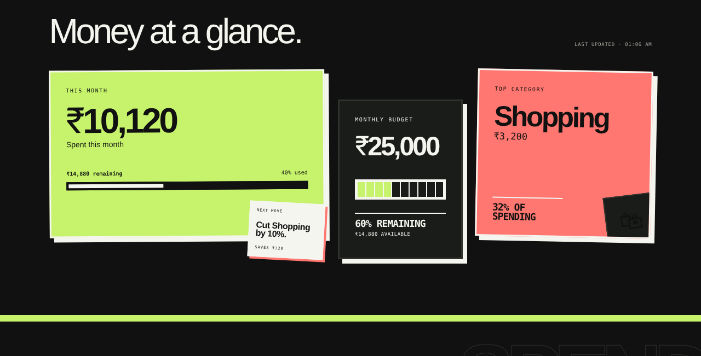

# Penny 
## Personal Expense Tracker

**Take control of your money, one expense at a time.**

Penny is a full-stack expense tracker designed to help you record daily spending, monitor your monthly budget, understand where your money goes, and manage recurring subscriptions — all in one place.

<p align="center">
  <a href="https://penny-expensetracker-frontend.vercel.app/">
    <strong>🚀 Open Penny Live</strong>
  </a>
</p>

<p align="center">
  
  
  
  
</p>

---

## Explore Penny

<p align="center">
  <strong>Landing Page</strong><br/>
  
</p>

<p align="center">
  <strong>Expense Dashboard</strong><br/>
  
  
</p>

## Features

###  Track Every Expense
- Add, edit, and delete expenses.
- Record amounts, categories, dates, and notes.
- Review spending across different time periods.

### ⚡ Quick Add
Enter expenses using simple text:

| Input | What Penny parses |
|---|---|
| `Coffee 180 food today` | Amount, category, and date |
| `Uber 240 yesterday` | Amount and date |

Penny uses a **rule-based parser**, not an AI model, to extract expense details from supported inputs.

###  Understand Your Spending
- View monthly spending summaries.
- Explore category-wise expense breakdowns.
- Filter expenses by date range.
- Compare spending against your monthly budget.

###  Set Your Budget
- Configure your monthly spending limit.
- Customize expense categories.
- Track expenses against your budget.

###  Manage Subscriptions
- Add recurring subscriptions.
- Edit subscription details.
- Pause, resume, or remove subscriptions.

###  Your Account, Your Settings
- Register and sign in securely.
- Update your display name and password.
- Configure budget and category preferences.

---
## Tech Stack

### Frontend


### Backend


### Database


### Deployment & Hosting


##  Architecture

Penny separates the user interface, API, and database into independently deployed layers.

```text
┌─────────────────────────────┐
│       React Frontend        │
│    React 19 + Vite + Axios  │
│           Vercel            │
└──────────────┬──────────────┘
               │
               │ HTTPS + JWT
               ▼
┌─────────────────────────────┐
│        Express API          │
│   Authentication + Logic    │
│           Render            │
└──────────────┬──────────────┘
               │
               │ SQL Queries
               ▼
┌─────────────────────────────┐
│         MySQL DB             │
│            Aiven             │
└─────────────────────────────┘
```


## Project Structure

```text
src/
├── api/          # Axios client and API helpers
├── components/   # Dashboard widgets and reusable UI
├── lib/          # Formatting utilities and quick-add parser
├── pages/        # Landing, Login, Register, SetupWizard,
│                 # Dashboard and Settings
└── styles/       # Component and page styles
```


---

<p align="center">
 personal expense tracking made simpler
</p>
